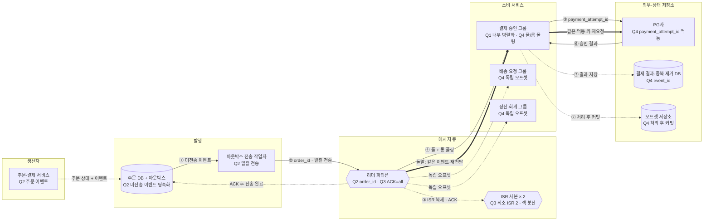

# 4장 분산 메시지 큐 — 김준현(whitejh) · S2 안전결제

## 1. 전제

| 핵심 숫자 | 값 | 계산식 |
|---|---|---|
| 평균 / 피크 쓰기 처리량 | 40MB/s·2만 건/s / 200MB/s·10만 건/s | 2만 건/s × 2KB, 피크 × 5 |
| 30일 저장 용량 | 360TB (사본 3개 포함) | 40MB/s × 10⁵초 × 30일 × 3 |
| 필요한 파티션 수 | 계산상 2,000개 | max(200MB/s ÷ 10MB/s, 10만 건/s ÷ 50건/s) |

- **교재와 다른 제약**: 유실과 중복 결제를 허용하지 않고 주문별 순서를 보장해야 하며, PG 호출 때문에 소비자 1명의 처리 속도가 50건/s로 느리다.

## 2. 결정 4개

| # | 결정 | 질문 | 내 선택 | 근거 (한 줄) | 감수한 것 |
|---|---|---|---|---|---|
| Q1 | 규모 추정 | 피크 10만 건/s인 결제 큐의 처리량·저장량·필요 파티션 수와 첫 병목은? | 평균 40MB/s, 피크 200MB/s·10만 건/s, 360TB, 계산상 파티션 2,000개·병목은 소비자 처리 속도 | 소비자 1명이 50건/s라 소비자 병렬성이 파티션 수를 결정함 | 실제로는 소비자 내부 비동기 병렬화로 파티션 수를 줄이되 주문별 순서·오프셋 커밋 복잡성을 감수 |
| Q2 | 파티션·생산자 | ① 주문 이벤트의 파티션 키와 순서 보장 범위는? ② 피크 200MB/s에서 생산자는 어떻게 전송할까? | 주문 ID 키로 주문별 순서 보장 / 일괄 전송 + 트랜잭셔널 아웃박스 | 주문별 순서를 지키고, 미전송 이벤트를 영속화해 버퍼 유실 없이 처리량을 확보 | 별도 테이블·전송 작업자 운영, ACK 후 완료 표시 전 장애 시 중복 가능 |
| Q3 ★ | 복제·ACK | 유실 0인 결제 이벤트를 몇 사본·어디에 두고 언제 ACK하며 어디서 읽을까? | ACK=all·최소 ISR 2, 사본 3개를 서로 다른 브로커·랙에 배치, 리더에서 읽기 | ISR이 하나뿐이면 가용성을 포기하고 쓰기를 거부해 유실 방지를 우선 | 느린 ISR에 따른 지연, 사본 3개의 저장·복제 비용, ACK 유실 시 중복 가능 |
| Q4 | 소비·전달 보장 | PG 승인 후 오프셋 커밋 전에 죽어 같은 메시지를 다시 읽으면 어떻게 소비·커밋하고 중복 결제를 막을까? | 풀 + 롱 폴링, 용도별 3개 그룹, 최소 1회, 결과 저장 후 커밋, payment_attempt_id 멱등 처리 | 결제 유실보다 재전달이 안전하며 멱등 키로 효과상 정확히 한 번을 달성 | 중복 제거 상태 관리, PG 상태 조정, 재조정 중 소비 중단 |

## 3. 시스템 전체 설계도

실선 = 메시지 발행·소비 · 점선 = 쓰기·복제·부가 흐름 · 굵은 선 = 소비자 장애 후 재전달 대응

![[메시지큐설계_김준현_2026-11-08.excalidraw]]

**메시지 발행 → 소비**: ① 아웃박스에서 미전송 이벤트 조회 → ② 주문 ID로 라우팅해 일괄 전송 → ③ ISR 사본에 복제한 뒤 ACK → ④ 결제 그룹이 풀·롱 폴링 → ⑤ 멱등 키로 PG 결제 요청 → ⑥ 신규 또는 기존 승인 결과 수신 → ⑦ 결과 저장 후 오프셋 커밋
