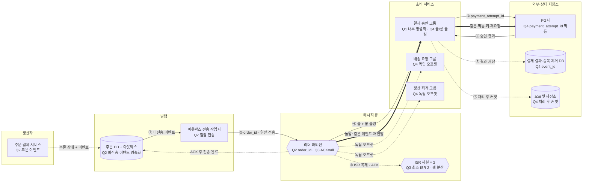

# ch04 미팅과제

> 이 파일을 직접 채워서 `main` 으로 push하면 제출됩니다.

> **한 줄 요약**: 주문 ID 파티셔닝과 트랜잭셔널 아웃박스로 유실을 막고, ACK=all·최소 ISR 2로 복제하며, 최소 1회 전달과 결제 멱등 키로 효과상 정확히 한 번 처리한다.

## 1. 전제

- **과제**: 주문 생성 → 결제 승인 → 배송 요청 이벤트를 처리하는 분산 메시지 큐를 설계한다.
- **생산자·소비자**: 주문·결제 서비스가 생산하고, 결제 승인·배송 요청·정산 회계의 세 소비자 그룹이 독립적으로 읽는다.
- **교재와 다른 제약**: 유실과 중복 결제는 0건이어야 하고 주문별 순서를 보장해야 한다. PG 호출 때문에 소비자 1명의 처리 속도는 50건/s로 느리다.

| 핵심 숫자 | 값 | 계산식 |
|---|---|---|
| 평균 쓰기 처리량 | 2만 건/s, 40MB/s | 2만 건/s × 2KB |
| 피크 쓰기 처리량 | 10만 건/s, 200MB/s | 평균 × 5 |
| 하루 저장량 | 4TB | 40MB/s × 10⁵초 |
| 30일 저장 용량 | 360TB (사본 3개 포함) | 4TB × 30일 × 3 |
| 처리량 기준 파티션 수 | 20개 | 200MB/s ÷ 파티션당 10MB/s |
| 소비자 기준 파티션 수 | 2,000개 | 10만 건/s ÷ 소비자당 50건/s |
| 필요한 파티션 수 | 계산상 2,000개 | max(20, 2,000) |

## 2. 결정

| # | 결정 | 내 선택 | 근거 (한 줄) | 감수한 것 |
|---|---|---|---|---|
| Q1 | 규모와 병목 | 평균 40MB/s, 피크 200MB/s, 360TB, 계산상 파티션 2,000개·병목은 소비자 처리 속도 | 소비자 1명이 50건/s라 소비자 병렬성이 파티션 수를 결정한다 | 실제로는 내부 비동기 병렬화로 파티션 수를 줄이되 주문별 순서와 오프셋 관리가 복잡해진다 |
| Q2 | 파티션 키·생산자 | 주문 ID 키로 주문별 순서 보장 / 일괄 전송 + 트랜잭셔널 아웃박스 | 같은 주문을 같은 파티션에 넣고, 주문 변경과 이벤트를 함께 영속화해 전송 전 장애에도 복구한다 | 별도 테이블·전송 작업자가 필요하고 ACK 후 완료 표시 전 장애 시 중복될 수 있다 |
| Q3 | 복제·ACK | ACK=all·최소 ISR 2, 사본 3개를 서로 다른 브로커·랙에 배치, 리더에서 읽기 | ISR이 하나뿐이면 쓰기를 거부해 가용성보다 결제 이벤트 유실 방지를 우선한다 | 느린 ISR만큼 지연되고 저장·복제 비용이 3배이며 ACK 유실 시 재전송될 수 있다 |
| Q4 | 소비·전달 보장 | 풀 + 롱 폴링, 용도별 3개 그룹, 최소 1회, 결과 저장 후 커밋, payment_attempt_id 멱등 처리 | 처리 전에 커밋해 결제를 잃는 것보다 재전달을 허용하고 중복 효과를 차단하는 편이 안전하다 | 중복 제거 상태와 PG 상태 조정이 필요하고 재조정 동안 소비가 중단된다 |

## 3. 전체 설계도

실선 = 메시지 발행·소비 · 점선 = 쓰기·복제·부가 흐름 · 굵은 선 = 소비자 장애 후 재전달 대응

![[메시지큐설계_김준현_2026-11-08.excalidraw]]

**핵심 흐름**: ① 아웃박스에서 미전송 이벤트 조회 → ② 주문 ID로 라우팅해 일괄 전송 → ③ ISR 사본에 복제한 뒤 ACK → ④ 결제 그룹이 풀·롱 폴링 → ⑤ 멱등 키로 PG 결제 요청 → ⑥ 신규 또는 기존 승인 결과 수신 → ⑦ 결과 저장 후 오프셋 커밋

**돌발 상황 풀이**: PG 승인 후 오프셋 커밋 전에 소비자가 죽으면 새 소비자가 같은 메시지를 다시 읽는다. PG에 동일한 `payment_attempt_id`로 요청해 기존 승인 결과를 받고, `event_id`로 중복 처리를 막은 뒤 결과를 저장하고 오프셋을 커밋한다.

## 4. 교재와 다르게 간 곳

| 결정 | 교재 | 나 | 이 시나리오에서 왜 |
|---|---|---|---|
| 생산자 버퍼 | 생산자 라이브러리의 메모리 버퍼에서 일괄 전송 | 트랜잭셔널 아웃박스 + 별도 전송 작업자 | 결제 이벤트는 브로커에 보내기 전에 생산자가 죽어도 유실되면 안 된다 |
| 파티션 확장 | 파티션을 미리 넉넉히 잡고 소비자를 추가 | 계산상 2,000개를 확인하되 소비자 내부 비동기 병렬화로 실제 파티션 수를 줄임 | 2,000개 파티션·6,000개 사본의 운영 부담을 줄이기 위해서다 |
| 정확히 한 번 | 정확히 한 번 전달 방식을 설정 가능 | 최소 1회 + PG·소비자 멱등 처리 | 메시지 브로커의 트랜잭션만으로 외부 PG 결제까지 원자적으로 묶기 어렵다 |

## 5. 미팅 안건

- **가장 자신 없는 결정**:
- **같이 이야기할 질문**: 계산상 2,000개인 파티션을 몇 개까지 줄이고 소비자 내부 병렬성을 얼마로 높여야 주문별 순서와 안전한 오프셋 커밋을 함께 지킬 수 있을까?
