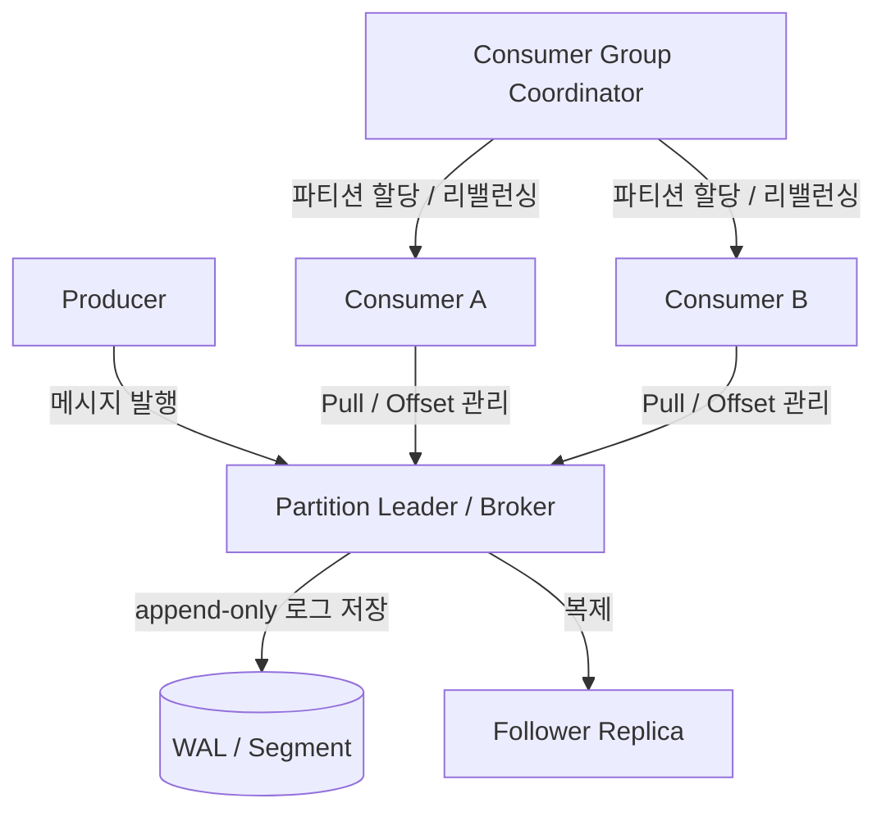

# ch19. 분산 메시지 큐 (Distributed Message Queue)

## 핵심 요약

### 1. 파티션과 소비자 그룹으로 처리량을 확장한다

메시지 큐는 생산자와 소비자를 분리하여 각 시스템을 독립적으로 확장할 수 있게 한다.<br> 
메시지 양이 많아지면 토픽을 여러 **파티션**으로 나누고 서로 다른 브로커에 분산 저장한다. 이때 메시지 순서는 토픽 전체가 아니라 **각 파티션 내부에서만 보장**된다.

따라서 같은 사용자의 이벤트 순서가 중요하다면 `userId`를 파티션 키로 사용해 동일한 파티션으로 보내는 방식이 유용하다.<br> 
같은 소비자 그룹 안에서는 하나의 파티션을 동시에 하나의 소비자만 담당하며, 소비자 수가 파티션 수보다 많으면 남는 소비자는 유휴 상태(작업 없이 대기하는 상태)가 된다.<br> 
소비자 추가·제거·장애 시에는 **리밸런싱**으로 파티션 담당자를 다시 배정한다.

### 2. 순차 기록과 배치 처리로 높은 처리량을 확보한다

메시지는 수정·삭제보다 추가와 순차 읽기가 많기 때문에, 일반적인 무작위 접근보다 **append-only 로그(WAL)** 구조가 적합하다.<br> 
파티션을 세그먼트 파일로 나누고 최신 세그먼트에 순차적으로 기록하면 디스크 접근 비용을 줄이고 OS의 페이지 캐시를 활용할 수 있다.<br>
또한 생산·저장·소비 단계에서 메시지를 **배치**로 처리하면 네트워크 왕복과 디스크 I/O 횟수를 줄일 수 있다. 다만 배치 크기를 키우면 처리량은 좋아지는 대신 개별 메시지가 배치를 기다리는 시간이 늘어 지연 시간이 커질 수 있다. 즉, 사용 사례에 따라 처리량과 지연 시간 사이의 균형을 잡아야 한다.

### 3. 메시지 전달 보장과 내구성은 장애 상황을 기준으로 설계한다

메시지 전달 방식은 **최대 한 번(at-most-once)**, **최소 한 번(at-least-once)**, 정확히 한 번(exactly-once)으로 구분한다.<br> 
특히 최소 한 번 방식은 메시지를 처리한 후 오프셋을 커밋하므로, 처리 직후 장애가 나면 같은 메시지를 다시 처리할 수 있다. 

따라서 소비자에서는 이벤트 ID를 기준으로 중복 처리를 방지하는 등 **멱등성**을 고려해야 한다.<br>
브로커 장애에 대비해 파티션을 리더와 팔로워 복제본에 분산하고 ISR(In-Sync Replicas)을 관리한다.<br> 
생산자의 `acks=0`, `acks=1`, `acks=all` 선택은 응답 속도와 데이터 내구성에 영향을 준다. `acks=all`도 `min.insync.replicas` 등 추가 설정과 함께 이해해야 한다.

### 1,2,3번 조금 더 쉽게 설명

### 1. 메시지를 나눠 저장하고, 여러 소비자가 나눠 처리한다

메시지 큐는 **작업을 요청하는 쪽(생산자)** 과  **실제로 처리하는 쪽(소비자)** 사이에서 메시지를 전달하는 시스템이다.<br> 
예를 들어 주문 서비스가 주문 완료 메시지를 큐에 넣으면, 알림 서비스가 이를 가져가 알림을 보낼 수 있다. 이렇게 하면 주문 서비스가 알림 처리가 끝날 때까지 기다릴 필요가 없다.

메시지가 너무 많아지면 하나의 **토픽(같은 종류의 메시지를 모아 둔 공간)** 을 여러 **파티션(메시지를 나눠 저장하는 구역)** 으로 나눠 처리한다.<br> 
단, **메시지 순서는 토픽 전체가 아니라 같은 파티션 안에서만 보장**된다. 따라서 동일한 사용자의 이벤트를 순서대로 처리해야 한다면 `userId`를 기준으로 같은 파티션에 보내는 것이 유리하다.

**소비자 그룹**은 여러 소비자가 일을 나눠 맡는 팀이라고 생각하면 쉽다. 같은 그룹에서는 하나의 파티션을 한 번에 한 소비자만 담당한다.<br>
예를 들어 **파티션이 3개인데 소비자가 5개라면, 3개는 메시지를 처리하고 2개는 담당할 파티션이 없어 대기한다.** 이를 **유휴 상태(작업 없이 대기하는 상태)** 라고 한다. 소비자가 추가되거나 장애로 빠지면 담당 파티션을 다시 나누는데, 이를 **리밸런싱**이라고 한다.

**한 줄 정리:** 파티션으로 작업을 나누면 여러 소비자가 동시에 처리할 수 있지만, 순서는 각 파티션 안에서만 보장된다.

### 2. 메시지를 한 개씩 기록하기보다 순서대로 모아서 처리한다

메시지 큐에 들어오는 데이터는 보통 기존 내용을 계속 수정하기보다 **새 메시지를 추가하고 나중에 읽는 방식**으로 사용된다. 따라서 파일의 중간을 이리저리 수정하는 대신, **일기장 맨 뒤에 새 내용을 덧붙이듯 기록하는 추가 전용 로그(append-only log, WAL 방식)** 가 잘 맞는다. 저장 파일은 여러 개의 **세그먼트(로그 파일 조각)** 로 나눠 관리할 수 있다.

또한 메시지를 한 건씩 네트워크로 보내거나 디스크에 기록하면 그때마다 처리 비용이 발생한다. **배치 처리**는 여러 메시지를 한 묶음으로 보내거나 기록하는 방법이다. 예를 들어 메시지 100개를 100번 나눠 보내는 대신 묶어서 보내면 네트워크 요청과 디스크 작업 횟수를 줄일 수 있다.

하지만 메시지를 충분히 모으려고 기다리면 첫 번째 메시지가 실제로 처리되기까지 시간이 길어질 수 있다. 즉, **한꺼번에 많이 처리하는 능력(처리량)** 과 **개별 메시지를 빨리 처리하는 능력(낮은 지연 시간)** 사이에서 균형을 잡아야 한다.

**한 줄 정리:** 메시지를 순서대로 저장하고 묶어서 처리하면 효율적이지만, 묶음이 커지면 기다리는 시간이 늘어날 수 있다.

### 3. 장애가 나도 메시지를 잃지 않고, 같은 작업을 두 번 처리하지 않도록 설계한다

메시지는 소비자가 처리하는 도중 장애가 날 수 있기 때문에, **언제 '처리 완료'로 인정할지** 정해야 한다. 여기서 **오프셋(offset)** 은 파티션 안에서 메시지의 위치를 나타내는 번호이고, **오프셋 커밋**은 소비자 그룹이 어디까지 처리했는지 기록하는 것이다.

- **최대 한 번(at-most-once):** 메시지를 중복 전달하지 않지만, 장애가 나면 일부 메시지를 놓칠 수 있다.
- **최소 한 번(at-least-once):** 실패하면 다시 전달해 누락 가능성을 줄이지만, 같은 메시지가 두 번 전달될 수 있다.
- **정확히 한 번(exactly-once):** 중복 없이 한 번 처리된 효과를 목표로 하지만 구현 제약과 비용이 크며, 외부 DB·API까지 자동으로 보장되지는 않는다.

예를 들어 소비자가 **주문 완료 기록을 DB에 저장했지만 오프셋을 기록하기 전에 종료**되면, 재시작 후 같은 메시지를 다시 받을 수 있다. 그래서 **멱등성(같은 작업을 여러 번 실행해도 최종 결과가 한 번 실행한 것과 같도록 만드는 성질)** 을 고려해야 한다. 이벤트 ID로 이미 처리한 주문인지 확인하는 방법이 대표적이다.

메시지를 저장하는 서버인 **브로커**가 고장 나는 상황에도 대비한다. 이를 위해 데이터를 여러 서버에 복제하고, **리더(메시지를 우선 받아 기록하는 복제본)** 와 **팔로워(리더 데이터를 복사하는 복제본)** 를 둔다.<br> 
**ISR** 은 리더의 데이터를 충분히 따라잡아 동기화된 복제본들의 목록이다. `acks=0`은 확인을 기다리지 않고, `acks=1`은 리더의 확인을 기다리며, `acks=all`은 설정된 조건에 따라 동기화된 복제본들의 확인까지 기다린다. 일반적으로 더 많은 복제 확인을 요구하면 메시지 유실 위험을 줄일 수 있지만 응답이 느려지거나 쓰기가 실패할 수도 있다.

**한 줄 정리:** 메시지를 다시 전달해 유실을 막는 것과, 재전달돼도 작업 결과가 중복되지 않게 하는 것은 서로 다른 문제다.

## 설계 정리

### 전체 구조



- **토픽/파티션:** 토픽을 여러 파티션으로 분할하여 병렬 처리한다. 같은 키의 메시지를 같은 파티션에 배치하면 해당 키의 순서를 유지하기 쉽다.
- **브로커/복제:** 리더가 쓰기를 받고 팔로워가 복제한다. 리더 장애 시 동기화된 복제본 중 새로운 리더를 선출해 가용성을 높인다.
- **소비자 그룹/오프셋:** 같은 그룹의 소비자들이 파티션을 나누어 읽는다. 그룹별로 읽은 위치를 관리하므로 서로 다른 그룹은 같은 메시지를 독립적으로 읽을 수 있다.
- **Pull 방식:** 소비자가 자신의 처리 속도에 맞춰 데이터를 가져온다. 데이터가 없을 때 불필요한 요청을 줄이기 위해 롱 폴링을 사용할 수 있다.

### 장애 시 메시지 재처리 흐름 (최소 한 번 전달)

1. 생산자가 메시지를 발행하고 브로커가 이를 기록·복제한다.
2. 소비자는 메시지를 가져와 비즈니스 로직을 처리한다.
3. 처리는 성공했지만 **오프셋 커밋 전에 장애**가 발생한다.
4. 재시작하거나 다른 소비자가 파티션을 넘겨받으면 마지막으로 커밋된 위치부터 다시 읽는다.
5. 같은 메시지가 재전달될 수 있으므로 소비자에서 **중복 처리 방지**가 필요하다.

> 핵심: 메시지가 유실되지 않게 재전달하는 것과 비즈니스 작업이 중복 실행되지 않게 하는 것은 별개의 문제다.

## 토론하고 싶은 것

### 1. 메시지 순서와 확장성의 균형

**질문:** 동일한 사용자에 대한 순서 보장을 위해 `userId`를 파티션 키로 사용한다면, 특정 사용자에게 트래픽이 몰리는 핫 파티션 문제는 어떻게 해결할 수 있을까?

**답변:** 같은 `userId`의 메시지를 동일한 파티션으로 보내면 그 사용자에 대한 순서를 보장하기 쉽다. 하지만 특정 사용자의 이벤트가 지나치게 많으면 해당 파티션에 부하가 집중된다. **파티션 수만 늘려서는 동일한 키가 여전히 한 파티션에 모이는 문제를 해결하기 어렵다.**

- **먼저 소비자 처리 성능을 개선한다.** 배치 처리, DB 쿼리 최적화, 불필요한 외부 호출 제거 등으로 핫 파티션의 처리 속도를 높인다.
- **순서 보장 범위를 재검토한다.** 사용자 단위 전체 순서가 필요하지 않다면 `userId + eventType` 또는 `userId + entityId` 등으로 키를 세분화해 부하를 분산할 수 있다. 단, 이렇게 하면 서로 다른 파티션에 분산된 이벤트 간 전체 순서는 보장되지 않는다.
- **정말 전체 순서가 중요하면 분산보다 일관성을 우선한다.** 예를 들어 같은 계좌의 입출금은 임의로 여러 파티션에 나눠 처리하기보다 한 키의 순서를 유지하면서 처리 용량을 확보해야 한다.

또한 파티션 수를 변경하면 기본 키 해시 방식에서 기존 키의 파티션 배치가 달라질 수 있어, 변경 전후 메시지의 순서 처리에도 주의가 필요하다.

**내 생각:** 핫 파티션은 단순히 파티션을 추가하는 문제라기보다 **어디까지 순서 보장이 필요한가**를 먼저 결정해야 하는 문제다. 사용자 전체 순서가 필요 없다면 키를 세분화하고, 필요하다면 해당 파티션의 처리 성능을 높이는 방향으로 접근하겠다.

### 2. 최소 한 번 전달과 멱등성

**질문:** 메시지를 정상 처리했지만 오프셋 커밋 전에 장애가 발생한 경우, DB 쓰기나 외부 API 호출의 중복 실행을 어떻게 막는 게 좋을까?

**답변:** 최소 한 번(at-least-once) 전달에서는 **비즈니스 로직 처리 성공 후 오프셋 커밋 전에 장애가 발생하면 동일한 메시지가 다시 전달될 수 있다.** 따라서 메시지 전달 자체를 한 번으로 제한하기보다 소비자가 **멱등성(idempotency)**을 보장하도록 설계하는 것이 현실적이다.

**DB 처리:** 메시지에 고유한 `eventId`를 부여하고 `(consumerName, eventId)`를 UNIQUE 키로 갖는 처리 이력 테이블을 사용한다. 이력 INSERT와 실제 비즈니스 데이터 변경을 **동일한 DB 트랜잭션**으로 묶는다. 중복 키가 발생하면 비즈니스 변경을 다시 하지 않고 넘어간다. DB 커밋이 끝난 후에 오프셋을 커밋한다.

```sql
CREATE TABLE processed_event (
    consumer_name VARCHAR(100) NOT NULL,
    event_id VARCHAR(100) NOT NULL,
    PRIMARY KEY (consumer_name, event_id)
);
```

상태 변경만 필요한 작업이라면 `UPDATE orders SET status = 'PAID' WHERE id = 123 AND status = 'PENDING'`처럼 **조건부 UPDATE**로 중복 반영을 방지할 수도 있다. 다만 재고 차감이나 포인트 적립처럼 다른 부수 효과가 있다면 그 작업도 함께 멱등하게 처리해야 한다.

**외부 API 처리:** DB 트랜잭션만으로는 외부 결제·알림 API의 중복 실행을 막을 수 없다. 외부 API가 `Idempotency-Key`를 지원한다면 메시지의 비즈니스 작업 ID를 키로 사용하고 재시도 시에도 **동일한 키**를 전달한다. 이를 지원하지 않는다면 요청 성공 여부 조회, 결과 대사(reconciliation), 수동 복구 등의 절차가 필요하다. 요청이 실제로 성공했지만 응답을 받기 전에 장애가 발생할 수도 있기 때문이다.

**내 생각:** `SETNX` 같은 락으로 **중복 메시지 발행**을 줄이는 것과, 장애 후 재전달된 메시지로 인한 **중복 비즈니스 처리**를 막는 것은 별개의 문제다. 최소 한 번 전달을 전제로 하고 DB는 이벤트 ID와 트랜잭션, 외부 API는 멱등성 키와 결과 확인으로 대응하겠다.

### 3. Redis Streams와 Kafka의 선택 기준

**질문:** 비교적 작은 규모의 서비스에서는 Redis Streams로도 충분할 수 있다. 처리량, 보존 기간, 재처리, 운영 복잡도 중 어떤 조건에서 Kafka 도입을 고려해야 할까?

**답변:** 단순히 사용자 수나 순간 처리량만으로 선택하기보다는 **메시지 보존 기간, 여러 소비자의 독립적인 재처리 필요성, 확장 규모, 운영 비용**을 기준으로 판단해야 한다.

| 비교 기준 | Redis Streams | Kafka |
| --- | --- | --- |
| 주요 용도 | 비동기 작업 큐, 비교적 단순한 이벤트 처리 | 대용량 이벤트 스트리밍, 여러 시스템 간 이벤트 공유 |
| 저장과 보존 | Redis 메모리 사용량 및 영속화 설정을 함께 고려하고 트리밍으로 보존 관리 | 디스크 기반 로그에 시간·용량 기준 보존 정책 설정 |
| 재처리 | 메시지가 보존되어 있다면 다시 읽을 수 있고, PEL·`XAUTOCLAIM` 등으로 미처리 메시지 복구 가능 | 소비자 그룹별 오프셋을 이동해 과거 로그를 다시 소비하기 편리함 |
| 확장 | Redis 인스턴스·샤딩·스트림 설계 등을 고려 | 파티션과 여러 브로커를 이용해 처리량 확장 |
| 운영 부담 | 기존 Redis를 사용한다면 비교적 낮음 | 별도의 Kafka 클러스터와 파티션·복제·운영 관리 필요 |

**Kafka 도입을 검토할 상황**은 다음과 같다.

- 이벤트를 수일~수주 이상 보존하고, 이후 분석이나 감사 목적으로 다시 읽어야 할 때
- 하나의 이벤트를 알림·통계·검색·추천 등 **여러 서비스가 독립적으로 소비**하고 각자 재처리해야 할 때
- 높은 처리량 때문에 단일 인스턴스나 기존 Redis 구성에서 병목이 생겨 **파티션·브로커 단위의 수평 확장**이 필요할 때

다만 Redis Streams도 소비자 그룹, 메시지 보존, 재처리 기능이 있으므로 위 기능이 필요하다는 이유만으로 반드시 Kafka를 선택해야 하는 것은 아니다. 실제 데이터량과 장애 복구 요구를 비교해야 한다.

**내 프로젝트에 적용하면:** 

링크 저장 후 스크래핑과 AI 요약을 비동기로 처리하고, 실패 작업을 복구하는 것이 주목적이었기 때문에 **Redis Streams가 합리적인 선택**이었다. 

반면 앞으로 링크 저장 이벤트를 검색 인덱싱·추천·분석 서비스가 독립적으로 소비하고, 과거 이벤트를 장기간 보존해 재처리해야 한다면 Kafka 도입을 검토하겠다. 

중요한 것은 기술 자체보다 **현재 요구사항에 비해 운영 복잡도를 과도하게 늘리지 않는 것**이다.

## 더 찾아본 것 (선택)

### Redis Streams로 구현한 비동기 처리와의 연결

개인 프로젝트에서는 링크 저장 요청 시 스크래핑과 AI 요약을 동기 처리하던 구조를 비동기 방식으로 개선했다. 

요청은 우선 `PENDING` 상태로 저장한 뒤 Redis Stream에 작업을 발행하고, 소비자가 작업을 수행한 후 완료 상태를 기록했다. 

동일한 링크에 대한 중복 작업 발행을 막기 위해 Redis `SETNX` 락과 대기 사용자 집합도 사용했다.

이번 장을 읽으며 **작업을 큐에 한 번만 발행하는 것과 작업이 정확히 한 번 실행되는 것은 다르다**는 점이 중요하다고 느꼈다. 소비자 장애나 재전달 가능성을 고려해 작업 상태 확인, 멱등성, 재시도 및 실패 작업 복구까지 함께 설계해야 한다.

추가로, Redis Streams의 소비자 그룹과 Kafka의 소비자 그룹은 모두 병렬 처리에 활용되지만 데이터 보존, 파티션 기반 확장, 재처리 방식 등이 완전히 같지는 않다.

**참고 자료**

- [원문: 19장 분산 메시지 큐](https://github.com/mobrava/system-design-notes-ko/blob/main/19.%20Distributed%20Message%20Queue/README.md)
- [Redis 공식 문서: Streams](https://redis.io/docs/latest/develop/data-types/streams/)
- [Apache Kafka 공식 문서](https://kafka.apache.org/documentation/)
- [LY Corporation 기술 블로그: Redis Streams를 활용한 메시지 큐잉 시스템](https://techblog.lycorp.co.jp/ko/building-a-messaging-queuing-system-with-redis-streams)
