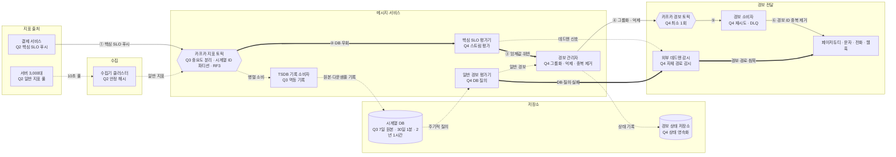

# 5장 지표 모니터링 및 경보 시스템 — whitejh · S4 결제SLO

> **한 줄 요약**: 일반 지표는 풀, 핵심 SLO는 내구성 있는 푸시로 수집하고, 카프카 스트림 평가로 DB 장애 중에도 30초 경보를 지킨다.

## 1. 전제

| 핵심 숫자 | 값 | 계산식 |
|---|---|---|
| 초당 데이터 포인트 수 | 16만/s | 3000×500÷10초 + 1만÷1초 |
| 2년 저장량 | 원본 약 187TB / 다운샘플링 후 약 3.2TB | 256GB/일×730일 / 7일 원본+23일 1분+723일 1시간 |

- **교재와 다른 제약**: 사업 지표 포함, 핵심 SLO 지표는 1초 주기이며 경보는 30초 내 전달·누락 0건을 요구

## 2. 결정 4개

| # | 결정 | 질문 | 내 선택 | 근거 (한 줄) | 감수한 것 |
|---|---|---|---|---|---|
| Q1 | 규모와 우선 병목 | 151만 시계열·초당 16만 포인트·2년 보관에서 무엇이 먼저 한계에 닿는가? | 질의·경보 평가 경로 | 데이터 처리량과 저장량은 확장 가능하지만 DB 장애·지연은 30초·누락 0건 SLO 위반으로 직결 | 쓰기 폭증과 복제에 필요한 추가 용량은 별도 확보 |
| Q2 | 지표 수집 방식 | 서버 3,000대의 10초 지표와 SLO 1만 개의 1초 지표를 어떻게 수집하고 여러 수집기에 나눌까? | 일반 지표는 풀+안정 해시 / 핵심 SLO는 내구성 있는 푸시 스트림 | 풀로 출처 신뢰성·장애 진단을 확보하고, 결제 SLO는 주기적 스냅샷에만 맡기지 않아 누락 위험을 줄임 | 경로 이원화, 시간 정렬·중복 처리·장애 추적 복잡도 |
| Q3 | 전송·데이터 축소 | ① 수집기와 DB 사이를 어떻게 완충할까? ② 2년 데이터를 어디서 어떤 해상도로 줄일까? | 우선순위별 카프카 토픽+시계열 ID 파티션, TSDB 기록·스트림 평가 병렬 소비 / 7일 원본→30일 1분→2년 1시간 | DB 장애를 완충하고 핵심 SLO의 순서·우선순위를 지키며 합·개수·최소·최대로 장기 분석 정확도를 보존 | 카프카 운영·중복 제거, 7일 이후 개별 포인트 소실 |
| Q4 | 경보 평가·전달 | ① DB 장애 중에도 경보를 어떻게 평가할까? ② 경보 폭주를 줄이고 전달을 어떻게 보장할까? | 핵심 SLO 스트림 평가+일반 DB 질의 / 그룹화·억제+상태 저장+최소 1회 전달 | DB 장애가 핵심 경보를 침묵시키지 않고 경보 ID로 재시도와 중복 제거를 함께 처리 | 이중 평가 모델, 상태 복구·규칙 일관성·자체 감시 운영 |

> 바뀐 결정: Q3 단일 DB 기록 경로 → TSDB 기록 소비자와 핵심 SLO 스트림 평가기의 병렬 소비 (돌발)

<strong>Q1~Q4 결정 과정 쉽게 다시 보기</strong>

이 설계의 핵심은 **중요한 결제 지표는 DB가 고장 나도 즉시 경보를 울리고, 나머지 지표는 일반적인 모니터링 방식으로 저장·조회하는 것**이다. 지표는 시간에 따라 변하는 숫자, 시계열은 같은 이름·레이블 조합으로 값이 이어지는 흐름, 데이터 포인트는 특정 시각의 측정값 하나다.

**Q1 — 데이터가 얼마나 많고 무엇이 가장 위험한가?** 일반 지표는 `3,000대 × 500개 = 150만 시계열`, 10초 주기이므로 초당 15만 포인트다. 여기에 1초 주기 SLO 1만 포인트를 더하면 초당 16만 포인트다. 하루 원본은 약 256GB, 2년 원본은 약 187TB지만 오래된 데이터를 1분·1시간 단위로 줄이면 약 3.2TB다. 저장량은 확장할 수 있지만 DB 장애가 곧 경보 침묵으로 이어지므로, 가장 먼저 보호할 것은 저장 공간보다 **경보 평가 경로의 가용성**이다.

**Q2 — 지표를 어떻게 가져올까?** 풀은 중앙 수집기가 서버에 요청하므로 응답 부재를 장애로 판단하기 쉽고, 푸시는 서버가 즉시 전송하므로 빠르다. 일반 CPU·메모리 지표는 10초마다 풀로 가져오고, 수집기들은 안정 해시 링으로 서버를 나눠 맡는다. 핵심 결제 SLO는 주기적인 수집을 기다리지 않고 내구성 있는 스트림으로 푸시한다. 대신 두 경로의 시간 정렬·중복 처리·장애 추적이 복잡해진다.

**Q3 — 데이터를 어떻게 안전하게 운반하고 저장할까?** 수집기와 시계열 DB 사이에 카프카를 둬서 DB가 멈춰도 데이터를 보관한다. 일반 지표와 핵심 SLO는 토픽을 분리하고, 시계열 ID를 기준으로 파티션을 골라 같은 시계열의 순서를 유지한다. 핵심 SLO 토픽은 `TSDB 기록 소비자`와 `스트림 경보 평가기`가 병렬로 읽는다. 보관은 7일 원본 → 30일까지 1분 → 2년까지 1시간이며, 평균 대신 최소·최대·합·개수도 남긴다. 결제 실패율은 비율의 평균이 아니라 실패 건수와 전체 건수를 저장해 다시 계산한다.

**Q4 — DB가 고장 나도 어떻게 경보를 울릴까?** 핵심 SLO는 카프카 스트림에서 바로 평가하고 일반 경보는 시계열 DB를 질의한다. 경보 관리자는 같은 PG사 장애를 하나로 그룹화하고, 중복을 제거하며, 원인 경보가 활성화되면 파생된 하위 경보를 억제한다. 외부 알림은 완전한 1회 전달보다 `최소 1회 전달 + 경보 ID 중복 제거`로 구현한다. 별도의 외부 데드맨 감시가 경보 시스템의 생존 신호를 확인해 경보 시스템 자체의 장애도 발견한다.

`일반 지표: 서버 → 풀 수집기 → 카프카 → 시계열 DB → 일반 경보`  
`핵심 SLO: 결제 서비스 → 카프카 → 스트림 평가 → 즉시 경보` (동시에 시계열 DB에도 저장)

## 3. 시스템 전체 설계도

실선 = 핵심 SLO 수집→경보 발령 · 점선 = 쓰기·비동기·일반 지표 경로 · 굵은 선 = DB 장애 대응

![[모니터링설계_whitejh_2026-11-15.excalidraw]]

**지표 수집 → 경보 발령**: ① 핵심 SLO 푸시 → ② 카프카에서 DB 우회 → ③ 스트림 임계값 평가 → ④ 그룹화·억제 → ⑤ 경보 토픽 → ⑥ 중복 제거 후 알림

## 4. 교재와 다르게 간 곳

| 결정 | 교재 | 나 | 이 시나리오에서 왜 |
|---|---|---|---|
| 수집 | 풀 또는 푸시 비교 | 일반 풀 + 핵심 SLO 푸시 | 1초 사업 지표를 주기적 스냅샷에만 맡기지 않음 |
| 경보 평가 | 경보 관리자가 TSDB 주기 질의 | 핵심 스트림 평가 + 일반 DB 질의 | DB 장애가 핵심 경보 침묵으로 이어지는 경로 차단 |
| 자체 감시 | 별도 언급 없음 | 외부 데드맨 감시 | 경보 시스템 자체가 죽은 상황을 독립적으로 호출 |

## 5. 미팅 안건

- **가장 자신 없는 결정**: Q4 경보 평가와 전달
- **같이 이야기할 질문**: 스트림 경보 규칙과 TSDB 질의 경보 규칙의 결과를 어떻게 일관되게 검증할까?
