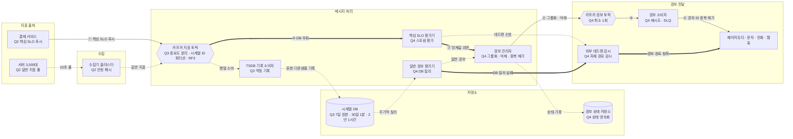

# ch05 미팅과제

> 이 파일을 직접 채워서 `main` 으로 push하면 제출됩니다.

> **한 줄 요약**: 일반 지표는 풀, 핵심 결제 SLO는 내구성 있는 푸시로 수집하고, 카프카 스트림 평가로 시계열 DB 장애 중에도 30초 경보를 지킨다.

## 1. 전제

- **과제**: 결제 플랫폼의 서버 지표와 결제 실패율 같은 핵심 SLO를 수집·보관하고, 실패율 급증 시 온콜 담당자에게 경보를 전달한다.
- **지표 출처**: 서버 3,000대 × 서버당 일반 지표 500개(10초 주기) + 핵심 SLO 시계열 1만 개(1초 주기).
- **교재와 다른 제약**: 사업 지표를 포함하고, 핵심 경보는 30초 안에 전달해야 하며 경보 누락 0건을 목표로 한다. 데이터는 2년 보관한다.

| 핵심 숫자 | 값 | 계산식 |
|---|---|---|
| 활성 시계열 수 | 151만 개 | 3,000×500 + 1만 |
| 초당 데이터 포인트 | 16만/s | 150만÷10초 + 1만÷1초 |
| 하루 원본 저장량 | 약 256GB | 16만/s × 10⁵초 × 16B |
| 2년 원본 저장량 | 약 187TB | 256GB/일 × 730일 |
| 다운샘플링 후 저장량 | 약 3.2TB | 7일 원본 + 23일 1분 + 723일 1시간 |
| 전체 경보 규칙 평가 빈도 | 150회/s | 핵심 스트림 300÷5초 = 60/s + 일반 DB 질의 2,700÷30초 = 90/s |

## 2. 결정

| # | 결정 | 질문 | 내 선택 | 근거 (한 줄) | 감수한 것 |
|---|---|---|---|---|---|
| Q1 | 규모와 우선 병목 | 151만 시계열·초당 16만 포인트·2년 보관에서 무엇이 먼저 한계에 닿는가? | 질의·경보 평가 경로 | 데이터 처리량과 저장량은 확장 가능하지만 DB 장애·지연은 30초·누락 0건 SLO 위반으로 직결된다 | 쓰기 폭증과 복제에 필요한 추가 용량은 별도 확보 |
| Q2 | 지표 수집 방식 | 일반 10초 지표와 핵심 1초 SLO를 어떻게 수집하고 여러 수집기에 나눌까? | 일반 지표는 풀+안정 해시 / 핵심 SLO는 내구성 있는 푸시 | 풀로 출처 신뢰성·장애 진단을 확보하고, 결제 SLO는 주기적 스냅샷에만 맡기지 않아 누락 위험을 줄인다 | 경로 이원화, 시간 정렬·중복 처리·장애 추적 복잡도 |
| Q3 | 전송·데이터 축소 | ① 수집기와 DB 사이를 어떻게 완충할까? ② 2년 데이터를 어디서 어떤 해상도로 줄일까? | 중요도별 카프카 토픽+시계열 ID 파티션, TSDB 기록·스트림 평가 병렬 소비 / 7일 원본→30일 1분→2년 1시간 | DB 장애를 완충하고 핵심 SLO 순서를 지키며 합·개수·최소·최대로 장기 분석 정확도를 보존한다 | 카프카 운영·중복 제거, 7일 이후 개별 포인트 소실 |
| Q4 | 경보 평가·전달 | ① DB 장애 중에도 경보를 어떻게 평가할까? ② 경보 폭주를 줄이고 전달을 어떻게 보장할까? | 핵심 SLO 스트림 평가+일반 DB 질의 / 그룹화·억제+상태 저장+최소 1회 전달 | DB 장애가 핵심 경보를 침묵시키지 않고 경보 ID로 재시도와 중복 제거를 함께 처리한다 | 이중 평가 모델, 상태 복구·규칙 일관성·자체 감시 운영 |

> 바뀐 결정: Q3 단일 DB 기록 경로 → TSDB 기록 소비자와 핵심 SLO 스트림 평가기의 병렬 소비 (돌발)

## 3. 전체 설계도

실선 = 핵심 SLO 수집→경보 발령 · 점선 = 쓰기·비동기·일반 지표 경로 · 굵은 선 = DB 장애 대응

![[모니터링설계_whitejh_2026-11-15.excalidraw]]

**핵심 흐름**: ① 핵심 SLO 푸시 → ② 카프카에서 DB 우회 → ③ 스트림 임계값 평가 → ④ 그룹화·억제 → ⑤ 경보 토픽 → ⑥ 중복 제거 후 알림

**돌발 상황 풀이**: 시계열 DB가 15분 동안 질의 불능이어도 핵심 SLO 평가기는 카프카를 직접 읽어 결제 실패율 40%를 감지한다. TSDB 기록 소비자는 카프카에 밀린 데이터를 남겨 두고 복구 후 기록한다. 일반 경보 질의 실패와 데드맨 신호 중단은 외부 감시가 별도로 호출한다.

## 4. 교재와 다르게 간 곳

| 결정 | 교재 | 나 | 이 시나리오에서 왜 |
|---|---|---|---|
| 수집 | 풀 또는 푸시의 장단점을 비교 | 일반 풀 + 핵심 SLO 푸시 | 1초 사업 지표를 주기적인 스냅샷 수집에만 맡기지 않는다 |
| 경보 평가 | 경보 관리자가 TSDB를 주기적으로 질의 | 핵심 스트림 평가 + 일반 DB 질의 | DB 장애가 핵심 경보 침묵으로 이어지는 경로를 차단한다 |
| 자체 감시 | 별도 언급 없음 | 외부 데드맨 감시 | 경보 시스템 자체가 죽은 상황을 독립적인 경로로 호출한다 |

## 5. 미팅 안건

- **가장 자신 없는 결정**: Q4 경보 평가와 전달
- **같이 이야기할 질문**: 스트림 경보 규칙과 TSDB 질의 경보 규칙의 결과를 어떻게 일관되게 검증할까?
  - **내 답변**:  
  규칙 정의를 하나의 버전 관리 저장소와 공통 DSL로 관리하고, 스트림 평가기와 TSDB 질의 평가기가 같은 임계값·윈도 크기·`for` 지속 시간·데이터 없음 정책을 사용하게 한다.  
  새 규칙은 일정 기간 두 경로에서 동시에 그림자 평가하되 실제 호출은 스트림 결과만 사용한다.  
  TSDB 적재가 끝나면 같은 이벤트 시간 구간을 다시 질의해 경보 ID·발령/해제 시각·집계값을 대조하고, 허용 오차를 넘는 차이는 별도 메타 경보로 알린다.  
  늦게 도착한 데이터 때문에 결과가 달라질 수 있으므로 이벤트 시간·워터마크·윈도 경계 규칙도 명시하며, 실시간 판단의 기준은 스트림, 사후 검증과 재현의 기준은 TSDB로 둔다.
    

