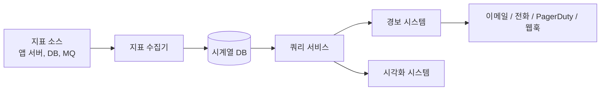
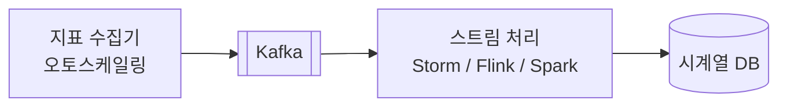
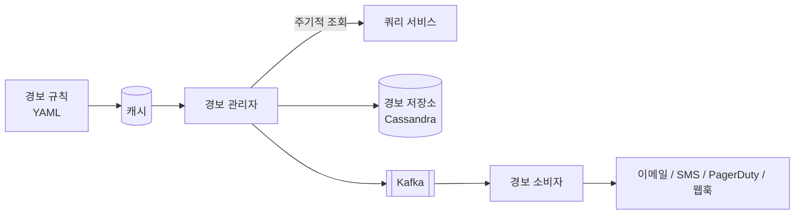
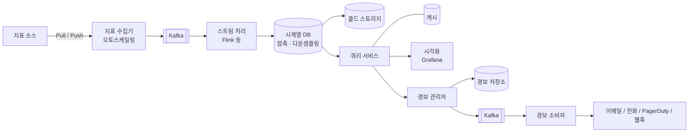

# 20장. 지표 모니터링 및 경보 시스템 — 정리·요약

> 출처: [mobrava/system-design-notes-ko — 20. Metrics Monitoring and Alerting System](https://github.com/mobrava/system-design-notes-ko/tree/main/20.%20Metrics%20Monitoring%20and%20Alerting%20System)

---

## TL;DR

- 약 **1,000만 개 지표**를 다루는 **사내용 인프라 모니터링·경보 시스템** 설계
- 흐름: **지표 소스 → 수집기(Pull/Push) → Kafka → 스트림 처리 → 시계열 DB(TSDB) → 쿼리 서비스(+캐시) → 경보 / 시각화**
- 핵심 판단
  - 저장소는 범용 DB 대신 **시계열 DB**(InfluxDB, Prometheus 등)
  - 수집 방식 **Pull vs Push**는 정답이 없고, 대규모 조직은 둘 다 지원할 수도 있음
  - **Kafka**로 수집과 처리를 분리해 DB 장애 시 데이터 손실을 막음
  - 저장 비용은 **인코딩·압축 + 다운샘플링 + 콜드 스토리지**로 줄임
  - 경보·시각화는 직접 만들기보다 **기성 솔루션**(Alertmanager류, Grafana)이 현실적

---

## 1단계. 요구사항 및 범위

### 기능 범위

| 항목 | 결정 |
|---|---|
| 대상 | 대형 기술 기업의 **사내용** (SaaS 아님) |
| 수집 지표 | CPU 부하, 메모리, 디스크 등 운영 지표 + 초당 요청 수 같은 상위 지표 |
| 제외 | 비즈니스 지표, **로그 수집**(ELK 영역), **분산 추적** |
| 경보 채널 | 이메일, 전화, PagerDuty, 웹훅 |

### 규모 추정

- DAU 1억 명
- 서버 풀 1,000개 × 풀당 머신 100대 × 머신당 지표 약 100개 ≈ **1,000만 개 지표**

### 데이터 보존 정책 (총 1년)

| 기간 | 해상도 |
|---|---|
| 0 ~ 7일 | 원시 데이터 |
| ~ 30일 | 1분 단위로 롤업 |
| ~ 1년 | 1시간 단위로 롤업 |

### 비기능 요구사항

- **확장성**: 지표·경보 수가 늘어도 수평 확장 가능
- **낮은 지연**: 대시보드·경보용 쿼리가 빨라야 함
- **신뢰성**: 중요한 경보를 놓치면 안 됨
- **유연성**: 새로운 기술을 쉽게 붙일 수 있어야 함

---

## 2단계. 개략적 설계

### 5대 핵심 컴포넌트

1. **데이터 수집** — 여러 소스에서 지표를 모음
2. **데이터 전송** — 소스 → 모니터링 시스템
3. **데이터 저장** — 정리·저장
4. **경보** — 이상 징후 탐지 후 알림
5. **시각화** — 그래프·차트

### 데이터 모델: 시계열(Time Series)

- 시계열 하나 = **지표 이름 + 레이블(태그) 집합 + (타임스탬프, 값) 배열**
- 표현 형식 예: **라인 프로토콜** (Prometheus, OpenTSDB 등에서 사용)

  ```
  CPU.load host=webserver01,region=us-west 1613707265 50
  ```

- 질의 예: "지난 10분간 us-west 리전 웹 서버들의 평균 CPU 부하" → 레이블로 필터링 후 값 평균
- **접근 패턴**: 쓰기가 압도적으로 많고 꾸준함 / 읽기는 평소 적지만 **장애 시 급증**

### 저장소 선택

- **범용 RDB**: 전문가 튜닝 없이는 이 규모에 부적합 → 비권장
- **NoSQL**: 가능은 하지만 시계열에 맞는 확장형 스키마 설계가 어려움
- **시계열 DB(TSDB)** 사용
  - OpenTSDB — Hadoop/HBase 기반이라 해당 인프라가 없으면 부담
  - Twitter MetricsDB, Amazon Timestream
  - 가장 많이 쓰이는 것: **InfluxDB, Prometheus** (인메모리 캐시 + 디스크 저장)
  - 참고 수치: InfluxDB는 8코어 / 32GB RAM으로 **초당 25만 건 이상 쓰기**
- TSDB 장점: 레이블별 인덱스로 대량 데이터를 빠르게 집계·분석
- 주의: **레이블 카디널리티를 낮게 유지**할 것 (고유 레이블 값이 너무 많으면 인덱스 폭증)
- 면접 기준: TSDB 내부 구조까지는 기대하지 않음 → "지표 = 시계열, 대표 TSDB를 안다" 수준이면 충분 (이력서에 썼다면 질문 가능)

### 개략적 아키텍처



| 컴포넌트 | 역할 |
|---|---|
| 지표 소스 | 앱 서버, SQL DB, 메시지 큐 등 |
| 지표 수집기 | 지표를 모아 TSDB에 기록 |
| 시계열 DB | 시계열 저장 + 전용 쿼리 인터페이스 |
| 쿼리 서비스 | TSDB 조회를 쉽게 함 (DB 인터페이스가 충분하면 생략 가능) |
| 경보 시스템 | 여러 채널로 알림 전송 |
| 시각화 시스템 | 그래프·차트로 표시 |

---

## 3단계. 상세 설계

### 3.1 지표 수집: Pull vs Push

> 지표는 일부 유실이 치명적이지 않으므로 **fire-and-forget**도 허용

#### Pull 모델 (예: Prometheus)

- 수집기가 서비스의 HTTP 엔드포인트(예: `/metrics`)에서 주기적으로 가져감
- 수집 대상 목록은 **서비스 디스커버리**(ZooKeeper, etcd)로 관리 → 풀 간격, IP, 타임아웃, 재시도 설정 포함
- 엔드포인트 변경은 이벤트 구독 또는 주기적 폴링으로 반영
- 수집기를 여러 대 둘 때 중복 수집 방지 → **일관 해시 링**으로 서버 집합을 수집기 하나에만 매핑

#### Push 모델 (예: CloudWatch, Graphite)

- 각 서버에 **수집 에이전트**를 설치해 수집기로 밀어 넣음
- 에이전트에서 **선집계** 가능 → 수집기 부하 감소
- 수집기가 과부하면 요청을 거절할 수 있음 → **로드 밸런서 + 오토스케일링 그룹** 필요

#### 비교

| 기준 | 유리한 쪽 | 이유 |
|---|---|---|
| 디버깅 | **Pull** | `/metrics`를 언제든 직접 열어 확인 가능 |
| 상태 확인 | **Pull** | 응답이 없으면 서버 다운을 바로 판단 (Push는 네트워크 문제와 구분 어려움) |
| 수명 짧은 배치 작업 | **Push** | Pull 전에 작업이 끝날 수 있음 (Pull은 Push Gateway로 보완) |
| 방화벽·복잡한 네트워크 | **Push** | Pull은 모든 엔드포인트에 접근해야 해서 멀티 DC에서 까다로움 |
| 성능 | Push 약간 | Push는 주로 UDP로 지연이 낮음 (단, TCP 연결 비용은 페이로드 대비 작다는 반론) |
| 데이터 진위성 | **Pull** | 수집 대상이 설정에 고정 / Push는 아무나 보낼 수 있어 허용 목록·인증 필요 |

→ **확실한 승자 없음.** 대규모 조직은 둘 다 지원해야 할 수 있음.

### 3.2 전송 파이프라인 확장: Kafka 도입



- 문제: TSDB가 죽으면 데이터 유실
- 해결: 수집기 → **Kafka** → 소비자/스트림 처리 → TSDB
- 장점
  - 신뢰성·확장성 높은 분산 메시징
  - **수집과 처리의 분리**
  - Kafka에 데이터가 남아 있어 **유실 방지**
- 파티셔닝: **지표 이름별 파티션** → 이름 단위 집계 용이 / 더 키우려면 태그로 세분화, 지표 우선순위 부여
- 단점: Kafka **운영 부담** → 대안으로 Facebook **Gorilla** 같은 대규모 인메모리 수집 시스템

### 3.3 집계 위치

| 위치 | 방식 | 장점 | 단점 |
|---|---|---|---|
| 수집 에이전트 | 단순 집계 (예: 1분 카운터 합산) | 전송량 감소 | 복잡한 로직 불가 |
| 수집 파이프라인 | Flink 등 스트림 엔진으로 DB 쓰기 전 집계 | 쓰기량 크게 감소 | 원시 데이터 미보관 → **정밀도 손실** |
| 쿼리 시점 | 조회할 때 집계 | **데이터 손실 없음** | 처리량이 커서 쿼리가 느릴 수 있음 |

### 3.4 쿼리 서비스

- 시각화·경보 시스템과 TSDB를 **분리** → 결합도↓, 필요 시 DB 교체 가능
- 앞단에 **캐시 계층**을 두어 TSDB 부하 감소
- 단, Grafana 등 대부분 도구가 주요 TSDB용 플러그인을 제공하고 TSDB 자체 캐시도 좋아서 **쿼리 서비스·캐시를 생략**할 수도 있음
- **SQL은 시계열 분석에 비효율적** → 대부분 TSDB는 전용 쿼리 언어 사용
  - 예: 지수 이동 평균을 SQL로 쓰면 윈도 함수·서브쿼리가 중첩되어 길고 복잡하지만, InfluxDB의 **Flux**로는 `range → filter → exponentialMovingAverage` 파이프라인 몇 줄이면 됨

### 3.5 저장 계층 최적화

- 근거: Facebook 연구 — 운영 저장소 쿼리의 **약 85%가 최근 26시간 데이터** 대상
  → 최근 데이터 접근에 최적화된 DB(예: InfluxDB)를 고르면 성능 이점이 큼
- 공통 최적화 기법
  1. **인코딩·압축**: 타임스탬프 전체 대신 **델타(차이값)** 저장 등 (좋은 TSDB는 기본 내장)
  2. **다운샘플링**: 오래된 데이터를 저해상도로 변환해 디스크 절약 (규칙은 데이터 담당자가 설정)
     - 7일: 원본 유지 / 30일: 1분 / 1년: 1시간
     - 예: 10초 간격 데이터 6개 → 30초 간격 평균값 2개로 축소
  3. **콜드 스토리지**: 거의 안 쓰는 오래된 데이터는 저렴한 저장소로 이동

### 3.6 경보 시스템



1. **규칙 정의**: YAML로 작성 후 캐시에 로드
   - 예: "`up == 0` 상태가 5분 이상 지속되면 `severity: page` 경보"
2. **경보 관리자**
   - 캐시에서 규칙을 읽고, 정해진 간격으로 쿼리 서비스를 호출해 조건 충족 시 경보 이벤트 생성
   - **필터링·병합·중복 제거** (같은 인스턴스 경보가 여러 번 떠도 이벤트는 1개)
   - **접근 제어** (경보 관리 권한 제한)
   - **재시도** → 최소 한 번(at-least-once) 전달 보장
3. **경보 저장소**: Cassandra 같은 KV DB에 모든 경보 상태 보관
4. **Kafka 게시** → **경보 소비자**가 각 채널로 알림 발송

→ 실무에서는 기성 솔루션이 많아 **직접 구축을 정당화하기 어려움**

### 3.7 시각화 시스템

- 기간별 지표·경보를 대시보드로 표시
- 고품질 시각화는 만들기 매우 어려움 → **Grafana** 같은 기성 도구 사용이 합리적

---

## 4단계. 최종 설계



---

## 면접에서 기억할 포인트

- **범위 확정부터**: 인프라 지표 vs 로그 vs 분산 추적을 구분하고, 보존 기간·해상도를 먼저 물어보기
- **지표 = 시계열 데이터** → 저장소는 TSDB, **레이블 카디널리티** 관리가 중요
- **쓰기 위주 + 장애 시 읽기 폭증**이라는 접근 패턴을 근거로 설계 선택을 설명
- **Pull vs Push**는 트레이드오프 표로 설명하고 "정답 없음, 둘 다 지원 가능"으로 마무리
- **Kafka**로 수집/처리 분리 → TSDB 장애 대비 (단점: 운영 부담, 대안: Gorilla)
- **집계 위치** 3가지(에이전트 / 파이프라인 / 쿼리)의 정밀도 vs 성능 트레이드오프
- 저장 비용 절감 3종: **델타 인코딩·압축, 다운샘플링, 콜드 스토리지**
- 경보 신뢰성: **중복 제거 + 재시도(at-least-once) + 상태 저장소**
- 경보·시각화는 **Build vs Buy** 관점에서 기성 솔루션 선택이 현실적

## 핵심 키워드

`시계열(Time Series)` `라인 프로토콜` `TSDB` `InfluxDB` `Prometheus` `레이블 카디널리티` `Pull / Push` `서비스 디스커버리` `일관 해시` `Push Gateway` `Kafka` `Flink` `Gorilla` `다운샘플링` `델타 인코딩` `콜드 스토리지` `Alertmanager` `at-least-once` `Grafana`