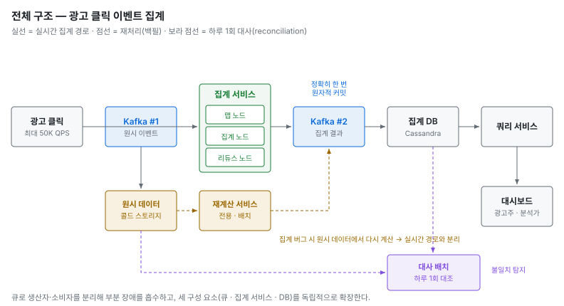
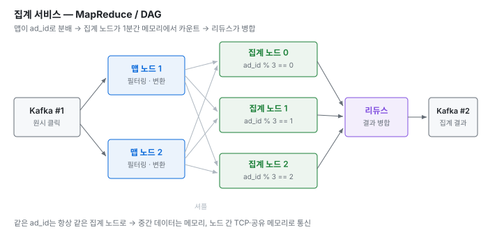
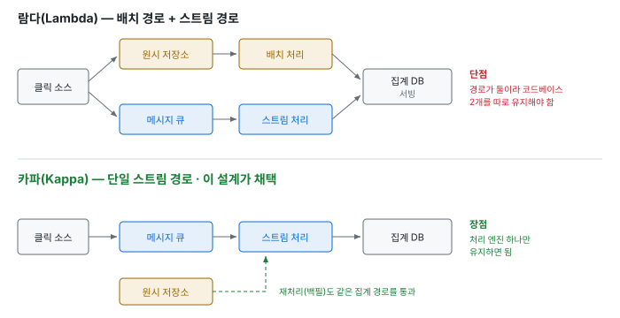
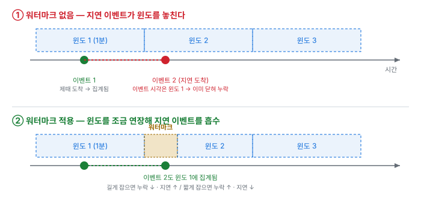
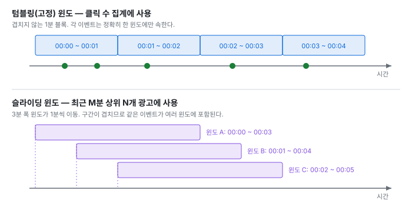
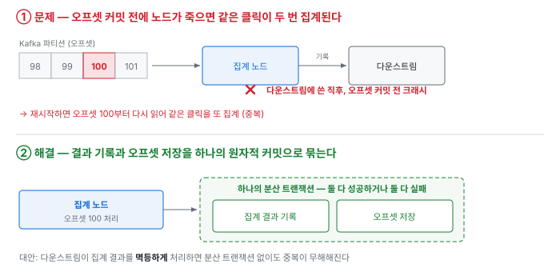
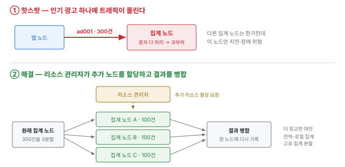

# 21장. 광고 클릭 이벤트 집계 — 정리·요약

---

## 핵심 요약

- 하루 **광고 클릭 10억 건**(평균 10,000 QPS, 최대 50,000 QPS)을 1분 단위로 집계하는 시스템
- 흐름: **광고 클릭 → Kafka(원시 이벤트) → 집계 서비스(MapReduce/스트림) → Kafka(집계 결과) → 집계 DB → 쿼리 API**
- 핵심 판단
  - 집계 결과가 **청구(돈)**에 쓰이므로 정확성이 최우선 → **정확히 한 번(exactly-once)** 전달
  - 타임스탬프는 **이벤트 시간** 사용 + **워터마크**로 지연 이벤트 흡수
  - **원시 데이터 + 집계 데이터 둘 다 저장** (원시는 콜드 스토리지, 재계산·디버깅용)
  - 배치/스트림을 한 경로로 합치는 **카파(Kappa) 아키텍처**
  - 하루 끝에 **대사(reconciliation)** 배치로 원시 데이터와 집계 결과를 비교

---

## 1단계. 요구사항 및 범위

### 기능 요구사항

| 항목 | 내용 |
|---|---|
| 집계 1 | 최근 Y분 동안 특정 `ad_id`의 클릭 수 |
| 집계 2 | 최근 M분 동안 가장 많이 클릭된 광고 상위 N개 |
| 필터링 | `ip`, `user_id`, `country` 기준 필터 지원 |
| 집계 주기 | 1분 |
| 규모 | Facebook / Google 수준 |

### 비기능 요구사항

- **정확성**: RTB·청구에 사용 → 작은 오차도 수백만 달러 차이
- **지연/중복 이벤트**를 올바르게 처리
- **견고성**: 부분 장애를 견딤
- **지연 시간**: 종단 간 수 분 수준 (RTB 자체는 1초 미만이지만 집계는 청구·보고용이라 여유 있음)

### 규모 추정

- DAU 10억 명, 1인당 하루 클릭 1건 → **하루 10억 건**
- 평균 10,000 QPS / 최대 50,000 QPS
- 클릭 1건 ≈ 0.1KB → **일 100GB, 월 3TB**
- 클릭 이벤트 수는 매년 30% 증가, 광고 수는 총 200만 개

---

## 2단계. 개략적 설계

### 쿼리 API

```
GET /v1/ads/{ad_id}/aggregated_count?from=&to=&filter=
→ { ad_id, count }

GET /v1/ads/popular_ads?count=&window=&filter=
→ { ad_ids: [...] }
```

- `filter`는 미리 정의한 필터링 전략의 ID (예: `001` = 미국 외 지역 클릭)

### 데이터 모델

**원시 데이터**

| ad_id | click_timestamp | user_id | ip | country |
|---|---|---|---|---|
| ad001 | 2021-01-01 00:00:01 | user1 | 207.148.22.22 | USA |

**집계 데이터**

| ad_id | click_minute | filter_id | count |
|---|---|---|---|
| ad001 | 202101010000 | 0012 | 2 |

- `filter_id` → (region, IP, user_id) 조합을 가리키는 식별자
- 상위 N개 광고는 별도 구조로 유지: `window_size`, `update_time_minute`, `most_clicked_ads(배열)`

**원시 vs 집계 — 왜 둘 다 저장하나**

| | 장점 | 단점 |
|---|---|---|
| 원시 데이터 | 전체 데이터 보존, 필터링·재계산 가능 | 저장 공간 큼, 쿼리 느림 |
| 집계 데이터 | 작고 쿼리 빠름 | 파생 데이터라 정보 손실 |

→ 집계 버그 시 **백필**할 수 있도록 원시 데이터는 보관하되 **콜드 스토리지**로 비용 절감,
쿼리 성능을 위해 집계 데이터도 함께 저장.

**DB 선택**: 쓰기 중심(원시) + 읽기·쓰기 모두 많음(집계) → 대규모 쓰기에 강한 **Cassandra**
(대안: InfluxDB, 또는 S3 + Parquet/ORC/AVRO 컬럼형 포맷)

### 전체 구조



- **메시지 큐(Kafka)로 생산자·소비자 분리** → 소비자가 죽어도 전체가 멈추지 않음
- **큐 #2가 따로 있는 이유**: 집계 결과 쓰기와 오프셋 커밋을 원자적으로 묶어
  종단 간 **정확히 한 번** 의미 체계를 달성하기 위함

### 집계 서비스 — MapReduce / DAG



- **맵 노드**: 데이터를 읽어 필터링·변환하고 `ad_id` 기준으로 집계 노드에 분배
  - Kafka 파티션 구독만으로도 비슷하게 되지만, 같은 `ad_id`가 다른 파티션으로 갈 수 있고
    전처리(정제·변환) 여지가 필요해 맵 노드를 둠
- **집계 노드**: 1분마다 메모리에서 `ad_id`별 클릭 수를 셈
- **리듀스 노드**: 집계 결과를 모아 최종 결과 생성
- 중간 데이터는 메모리에 두고 노드 간 TCP/공유 메모리로 통신

**사용 사례별 적용**

1. **클릭 수 집계**: `ad_id % N`으로 파티셔닝해 병렬 카운트
2. **상위 N개 광고**: 각 노드가 **힙**을 유지해 상위 N개를 빠르게 뽑고 리듀스에서 병합
3. **데이터 필터링**: 필터 기준을 **미리 정의해 사전 집계** (스타 스키마, 필터 필드 = 차원)

   | ad_id | click_minute | country | count |
   |---|---|---|---|
   | ad001 | 202101010001 | USA | 100 |
   | ad001 | 202101010001 | others | 3000 |

   - 장점: 구현 쉬움, 기존 집계 서비스 재사용, 조회가 빠름
   - 단점: 필터 기준이 많아지면 버킷·레코드 수가 폭증

---

## 3단계. 상세 설계

### 3.1 스트리밍 vs 배치, 람다 vs 카파

| | 온라인 시스템 | 배치(오프라인) | 스트리밍(준실시간) |
|---|---|---|---|
| 응답성 | 클라이언트에 빠르게 응답 | 응답 불필요 | 응답 불필요 |
| 입력 | 사용자 요청 | 유한·경계 있는 대량 데이터 | 경계 없는 무한 스트림 |
| 출력 | 응답 | 구체화된 뷰, 집계 지표 | 구체화된 뷰, 집계 지표 |
| 측정 | 가용성, 지연 시간 | 처리량 | 처리량 + 지연 시간 |
| 예 | 온라인 쇼핑 | MapReduce | Flink |

- **람다**: 배치 경로 + 스트림 경로 2개 → 코드베이스 2개를 유지해야 함 (단점)
- **카파**: 단일 스트림 처리 엔진으로 통합 → **이 설계가 채택한 방식**



**재계산(백필) 흐름**: 원시 저장소에서 데이터를 읽어(배치) → **전용 집계 서비스**로 보내
실시간 경로에 영향 없이 재집계 → 큐 #2 → 집계 DB 갱신

### 3.2 시간 — 이벤트 시간 vs 처리 시간

| | 장점 | 단점 |
|---|---|---|
| 이벤트 시간 | 집계가 더 정확 | 클라이언트 시계 오류·악의적 조작 가능 |
| 처리 시간 | 서버 타임스탬프라 신뢰성 높음 | 이벤트가 늦게 오면 부정확 |

→ 정확성이 중요하므로 **이벤트 시간** 채택.

**워터마크(watermark)**: 집계 윈도를 의도적으로 조금 더 연장해 늦게 도착한 이벤트를 흡수



- 짧은 워터마크 → 누락 가능성 ↑, 지연 ↓
- 긴 워터마크 → 누락 가능성 ↓, 지연 ↑
- 아무리 길게 잡아도 누락은 0이 안 됨 → 확률 낮은 케이스는 최적화하지 말고 **대사로 보정**

### 3.3 집계 윈도

- 윈도 종류: 텀블링(고정), 호핑, 슬라이딩, 세션
- **클릭 수 집계 → 텀블링 윈도** (1분 단위로 겹치지 않게)
- **상위 N개 광고 → 슬라이딩 윈도** (최근 M분을 계속 이동)



### 3.4 전달 보장과 중복 제거

- 전달 보장 3종: 최대 한 번 / 최소 한 번 / **정확히 한 번**
- 보통은 최소 한 번으로 충분하지만, 여기선 작은 중복도 금액 차이를 만들어 **정확히 한 번** 필요



**중복 발생 원인**

- **클라이언트**: 같은 이벤트 재전송 (악의적 중복은 리스크 엔진에서 처리하는 게 적절)
- **서버 장애**: 집계 중 노드가 죽어 업스트림이 확인 응답을 못 받고 재전송
  → 같은 오프셋을 여러 번 처리

**대응 단계**

1. 마지막으로 처리한 오프셋을 HDFS/S3에 저장 → 하지만 결과가 다운스트림에 도달 못 할 위험 남음
2. **다운스트림 기록과 오프셋 저장을 원자적으로** 묶음 → 분산 트랜잭션 필요
3. (대안) 다운스트림이 집계 결과를 **멱등하게** 처리하면 분산 트랜잭션 불필요

### 3.5 시스템 확장

구성 요소 3개(메시지 큐 / 집계 서비스 / DB)가 분리되어 **독립적으로 확장** 가능.

- **메시지 큐**
  - 생산자는 제한 없음 → 쉽게 확장
  - 소비자는 소비자 그룹에 넣고 수를 늘림 (충분한 파티션을 **미리** 만들어 둬야 함)
  - 소비자가 수천 개면 리밸런싱이 오래 걸림 → 비혼잡 시간대에 수행
  - 지역별 토픽 분리 고려 (`topic_na`, `topic_eu` …)
- **집계 서비스**
  - MapReduce 노드 추가로 수평 확장
  - 처리량 증가: ① 멀티스레딩(간단) ② YARN 같은 리소스 제공자 + 멀티프로세싱(확장성 ↑, 실무에서 더 흔함)
- **데이터베이스**
  - Cassandra는 일관 해싱 기반 수평 확장 내장 → 노드 추가 시 자동 재분배, 수동 샤딩 불필요

**핫스팟**: 특정 인기 광고에 트래픽이 몰리는 문제



- 집계 노드가 리소스 관리자에 추가 리소스를 요청 → 이벤트를 여러 노드로 쪼개 처리 후 원 노드에 병합
- 더 정교한 대안: **전역-로컬 집계(Global-Local Aggregation)**, **고유 집계 분할(Split Distinct Aggregation)**

### 3.6 내결함성

- 집계는 메모리에서 일어나므로 노드가 죽으면 진행 중 데이터가 사라짐
- Kafka **소비자 오프셋**으로 읽기 지점은 복구 가능
- 상위 N개처럼 **중간 상태**가 있는 집계는 분 단위로 **스냅샷** 저장
- 복구: 새 노드가 **마지막 커밋 오프셋 + 최신 스냅샷**을 읽어 이어서 처리

### 3.7 모니터링과 정확성

모니터링할 지표

- **지연 시간**: 여러 지점의 타임스탬프를 추적해 종단 간 지연 파악
- **메시지 큐 크기**: 급증하면 집계 노드 추가. Kafka는 분산 커밋 로그라 **records-lag** 추적
- **집계 노드 리소스**: CPU, 디스크, JVM

**대사(reconciliation)**: 하루 끝에 도는 배치 작업으로 원시 데이터에서 집계를 다시 계산해
집계 DB의 값과 비교 → 불일치 탐지·보정

### 3.8 대체 설계

- 원시 클릭 데이터는 **Hive**에 저장 + 빠른 쿼리를 위해 **ElasticSearch** 계층
- 집계는 **ClickHouse / Druid** 같은 OLAP DB에서 수행
- 면접에서는 특정 도구의 내부 구조보다 **사고 과정과 트레이드오프 설명**이 더 중요

---

## 면접에서 기억할 포인트

- 집계 결과가 **돈(청구)** 과 직결된다는 점을 근거로 설계 선택을 정당화하기
- **원시 + 집계 둘 다 저장** → 디버깅·백필 가능성과 쿼리 성능을 동시에 확보 (원시는 콜드 스토리지)
- **큐를 두 개** 두는 이유를 정확히 한 번 의미 체계(원자적 커밋)로 설명
- **이벤트 시간 + 워터마크**, 그리고 "워터마크로도 못 막는 건 대사로 해결"까지 이어서 말하기
- 윈도는 용도별로 다르게: 클릭 수 = **텀블링**, 상위 N개 = **슬라이딩**
- 중복 제거 3단계(오프셋 저장 → 원자적 커밋 → 멱등 처리) 트레이드오프
- 핫스팟·내결함성(스냅샷 + 오프셋)까지 언급하면 깊이가 생김
- **람다 vs 카파** 구분, 이 설계는 카파

## 핵심 키워드

`RTB` `MapReduce` `DAG` `Kafka` `exactly-once` `원자적 커밋` `이벤트 시간` `처리 시간` `워터마크` `텀블링 윈도` `슬라이딩 윈도` `스타 스키마` `차원(dimension)` `Cassandra` `람다 아키텍처` `카파 아키텍처` `백필` `대사(reconciliation)` `records-lag` `핫스팟` `전역-로컬 집계` `스냅샷` `Flink` `Spark` `ClickHouse` `Druid`
